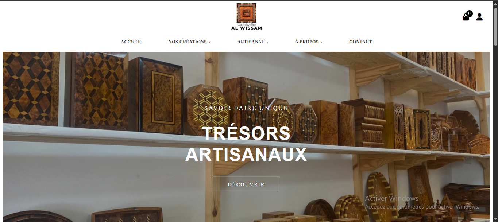
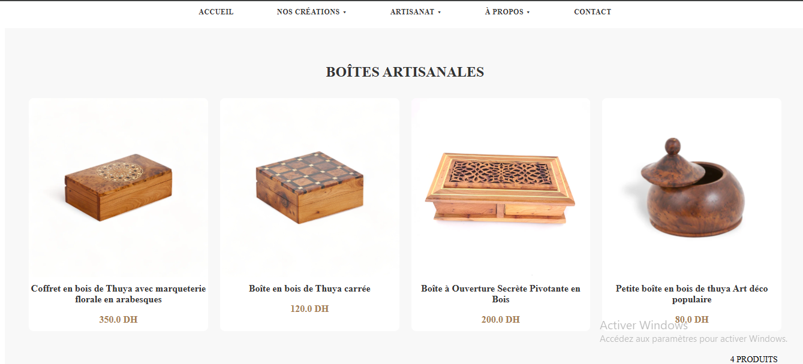
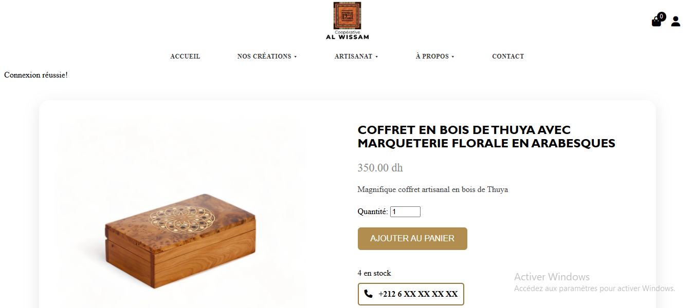
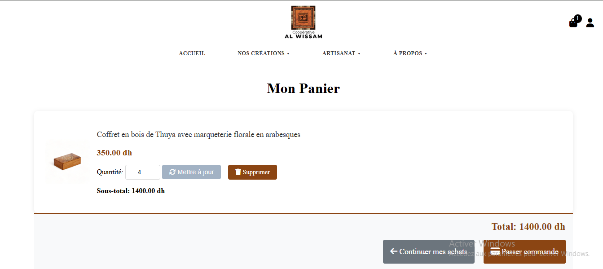
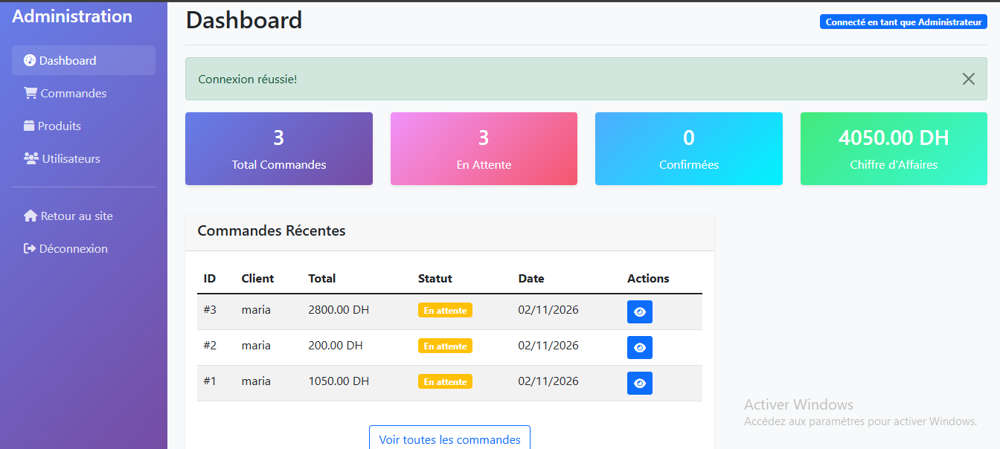
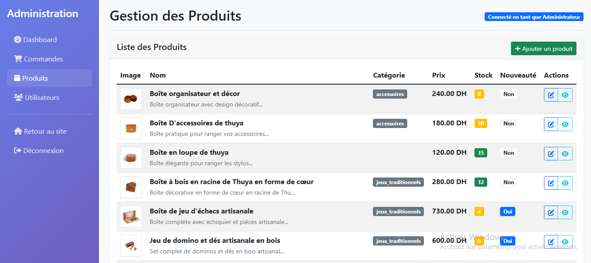

# Artisan E-commerce 

[Français](README.md) | **English**

E-commerce website built with Flask to sell handcrafted wooden products online. 
It includes a customer storefront (catalog, cart, checkout) 
and an admin area to manage products, orders and users.

## Context

Project carried out during the final-year internship of the DUT in Business Intelligence and Data Science at the École Supérieure de Technologie d'Essaouira (Cadi Ayyad University), for a craft cooperative.

## Screenshots

| Home | Catalog |
|---|---|
|  |  |

| Product detail | Cart |
|---|---|
|  |  |

| Admin dashboard | Product management |
|---|---|
|  |  |

## Features

**Customer area**
- Catalog by category (craft boxes, tableware, traditional games and accessories)
- Product detail page showing available stock
- Sign up and login, with hashed passwords (Flask-Bcrypt)
- Cart: add items, change quantities, remove items
- Checkout with a validated delivery form, confirmation page and cash on delivery

**Admin area**
- Dashboard with statistics (orders, pending orders, revenue)
- Order list with status filter, order details and status updates
- Product management: create, edit, delete, image upload
- User list
- Logging of important actions in log files

## Tech stack

- **Backend**: Python, Flask
- **Database**: SQLite, with Flask-SQLAlchemy
- **Authentication**: Flask-Login, Flask-Bcrypt
- **Frontend**: HTML, CSS, JavaScript

## Installation

Requirements: Python 3.9 or newer.

```bash
# 1. Clone the repository
git clone https://github.com/BENCHIKHMARIA/artisan-ecommerce-flask.git
cd artisan-ecommerce-flask

# 2. Create and activate a virtual environment
python -m venv venv
venv\Scripts\activate          # Windows
# source venv/bin/activate     # macOS / Linux

# 3. Install the dependencies
pip install -r requirements.txt

# 4. Run the application
python app.py
```

Then open **http://127.0.0.1:5000** in your browser.

On first launch, the app creates the database, a few demo products and an admin account. The password of that account is **randomly generated and printed in the terminal**: write it down at that moment.

### Optional settings (environment variables)

| Variable | Purpose |
|---|---|
| `SECRET_KEY` | Flask session secret key. Set your own value outside of local testing. |
| `ADMIN_EMAIL` | Admin account e-mail (default `admin@example.com`). |
| `ADMIN_PASSWORD` | Admin account password. If it is not set, a random password is generated. |
| `FLASK_DEBUG=1` | Enables Flask debug mode (development only). |

Example on Windows (PowerShell):

```powershell
$env:ADMIN_PASSWORD = "a-strong-password"
python app.py
```

## Project structure

```
artisan-ecommerce-flask/
├── app.py              # Models, routes, admin area, logs
├── templates/          # HTML pages (storefront and admin/)
├── static/             # CSS, JavaScript, images
├── screenshots/        # Images used in this README
└── requirements.txt
```


## About

Repository published by Maria Benchikh: [@BENCHIKHMARIA](https://github.com/BENCHIKHMARIA)
