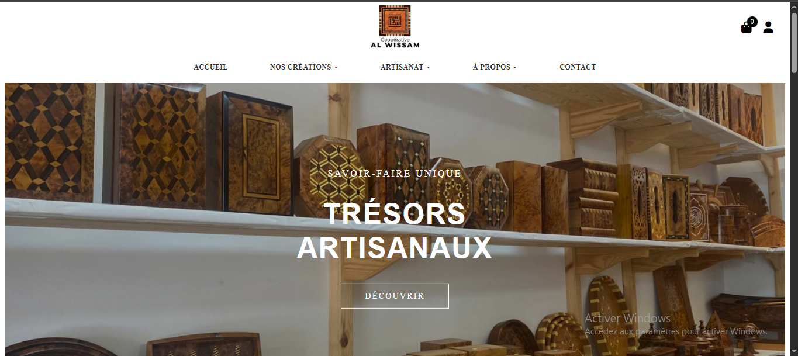
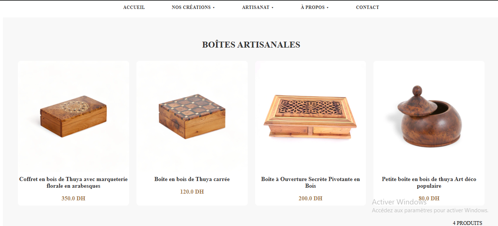
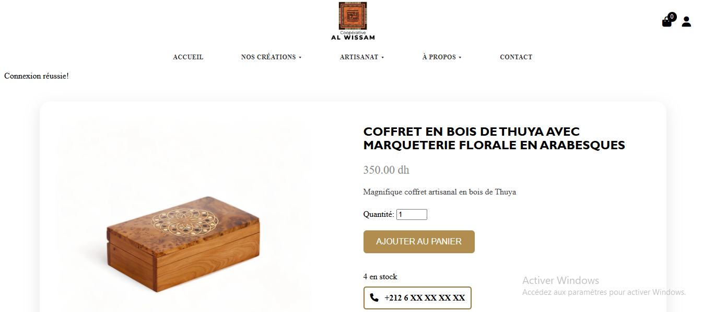
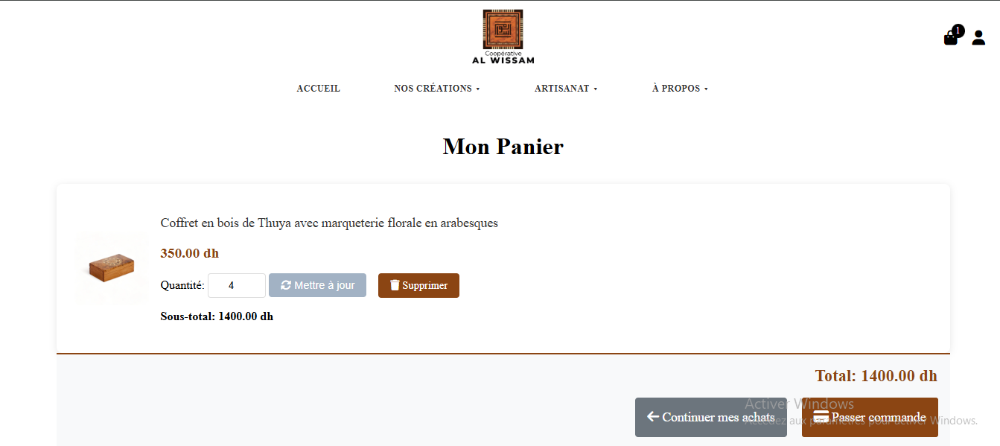
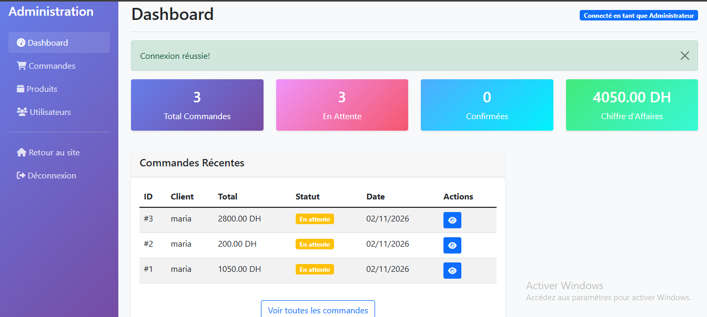
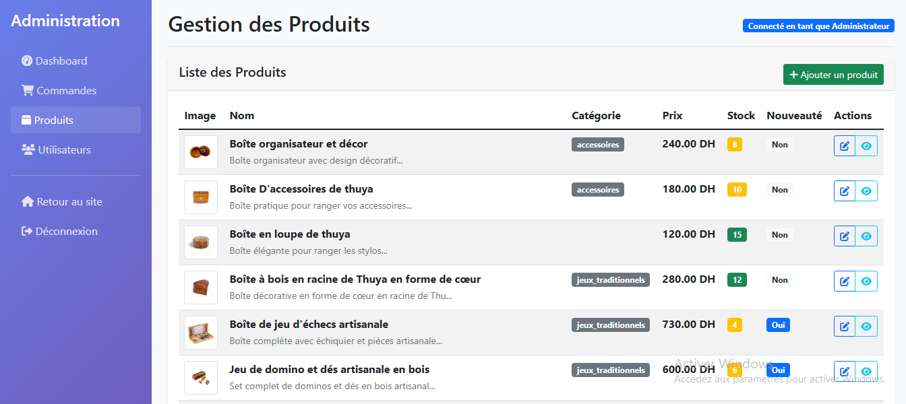

# Artisan E-commerce 

**Français** | [English](README.en.md)

Site e-commerce développé avec Flask pour la vente en ligne de produits artisanaux en bois. 
Il comprend une boutique pour les clients (catalogue, panier, commande) 
et un espace d'administration pour gérer les produits, les commandes et les utilisateurs.

## Contexte

Projet réalisé lors d'un stage de fin d'études du DUT en Informatique Décisionnelle et Sciences des Données, à l'École Supérieure de Technologie d'Essaouira (Université Cadi Ayyad), pour une coopérative artisanale.

## Captures d'écran

| Accueil | Catalogue |
|---|---|
|  |  |

| Détail d'un produit | Panier |
|---|---|
|  |  |

| Tableau de bord administrateur | Gestion des produits |
|---|---|
|  |  |

## Fonctionnalités

**Espace client**
- Catalogue par catégories (boîtes artisanales, art de la table, jeux traditionnels et accessoires)
- Page détail d'un produit avec stock disponible
- Inscription et connexion, avec mots de passe hachés (Flask-Bcrypt)
- Panier : ajout, modification de la quantité, suppression
- Commande avec formulaire de livraison validé, page de confirmation et paiement à la livraison

**Espace administrateur**
- Tableau de bord avec statistiques (commandes, commandes en attente, chiffre d'affaires)
- Liste des commandes avec filtre par statut, détail et changement de statut
- Gestion des produits : ajout, modification, suppression, téléversement d'images
- Liste des utilisateurs
- Journalisation des actions importantes dans des fichiers de logs

## Technologies

- **Backend** : Python, Flask
- **Base de données** : SQLite, avec Flask-SQLAlchemy
- **Authentification** : Flask-Login, Flask-Bcrypt
- **Frontend** : HTML, CSS, JavaScript

## Installation

Prérequis : Python 3.9 ou plus récent.

```bash
# 1. Cloner le dépôt
git clone https://github.com/BENCHIKHMARIA/artisan-ecommerce-flask.git
cd artisan-ecommerce-flask

# 2. Créer et activer un environnement virtuel
python -m venv venv
venv\Scripts\activate          # Windows
# source venv/bin/activate     # macOS / Linux

# 3. Installer les dépendances
pip install -r requirements.txt

# 4. Lancer l'application
python app.py
```

Ouvrir ensuite **http://127.0.0.1:5000** dans le navigateur.

Au premier lancement, l'application crée la base de données, quelques produits de démonstration et un compte administrateur. Le mot de passe de ce compte est **généré au hasard et affiché dans le terminal** : note-le à ce moment-là.

### Paramètres facultatifs (variables d'environnement)

| Variable | Rôle |
|---|---|
| `SECRET_KEY` | Clé secrète des sessions Flask. À définir avec une valeur personnelle hors test local. |
| `ADMIN_EMAIL` | E-mail du compte administrateur (par défaut `admin@example.com`). |
| `ADMIN_PASSWORD` | Mot de passe du compte administrateur. S'il n'est pas défini, un mot de passe aléatoire est généré. |
| `FLASK_DEBUG=1` | Active le mode debug de Flask (développement uniquement). |

Exemple sous Windows (PowerShell) :

```powershell
$env:ADMIN_PASSWORD = "un-mot-de-passe-solide"
python app.py
```

## Structure du projet

```
artisan-ecommerce-flask/
├── app.py              # Modèles, routes, administration, logs
├── templates/          # Pages HTML (boutique et admin/)
├── static/             # CSS, JavaScript, images
├── screenshots/        # Images utilisées dans ce README
└── requirements.txt
```


## À propos

Dépôt publié par Maria Benchikh : [@BENCHIKHMARIA](https://github.com/BENCHIKHMARIA)
